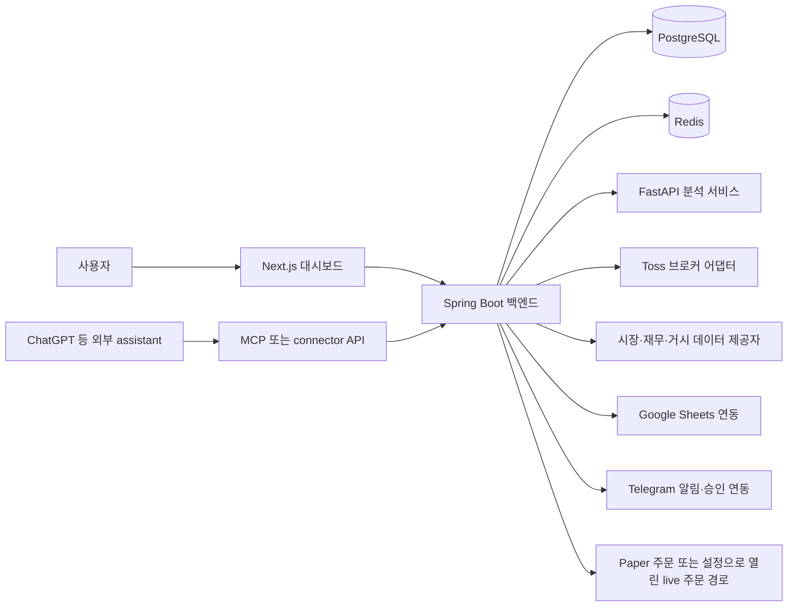

# 01 · 아키텍처와 기능 경계

> **조사 기준:** 2026-10-18 · commit `3e9aacafa72bd0315d14b4ac5c30912ac6b541fd`
> 정적 코드와 저장소 설정을 설명한다. 현재 배포가 이 값으로 실행 중인지, 외부 연동에 성공하는지에 대한 실시간 감사는 아니다.

## 한눈에 보는 구조

시스템은 세 개의 애플리케이션 서비스와 저장소, 선택 연결로 구성된다. 사용자 화면과 외부 assistant는 Spring API에 요청한다. Spring 백엔드는 도메인 상태와 저장소를 소유한다. 별도 stock/portfolio analysis 및 forecast workflow의 규칙 계산을 FastAPI 서비스에 위임하고, Investment OS context·데이터 상태·위험·전술 계산은 Spring 모듈에서 수행한다.

위 그림의 연결은 코드에 있는 호출·어댑터 경계다. 외부 계정, 네트워크, 제공자 정책, 자격 증명과 배포 설정이 있어야 실제 연결이 성립한다. Compose 파일은 로컬 서비스 구성의 선언이며, 그 컨테이너가 현재 실행 중이라는 증거는 아니다.

## 애플리케이션 책임

| 구성 요소 | 저장소에서 확인되는 책임 | 주요 근거 |
|---|---|---|
| **Next.js 대시보드** `web-dashboard/` | 로그인 세션을 사용해 Spring API를 호출하고, 계좌·홈·종목 분석·시장·이벤트·주문·포트폴리오·위험 정책·예측·설정·readiness UI를 표시한다. 승인 전 표시값을 요구하는 주문 UI와 상태별 화면이 있다. DB나 외부 provider를 직접 소유하지 않는다. | [`web-dashboard/lib/api.js`](../../web-dashboard/lib/api.js), [`web-dashboard/app/route-workspace.js`](../../web-dashboard/app/route-workspace.js), [`web-dashboard/app/`](../../web-dashboard/app/) |
| **Spring 백엔드** `trading-backend/` | 인증·권한, REST/MCP 경계, 브로커와 provider 호출, PostgreSQL 기록, 업무 흐름과 상태 전이를 조정한다. 도메인은 `account`, `broker`, `analysis`, `marketdata`, `investment`, `risk`, `monitoring`, `intelligence`, `order`, `prediction`, `connector`, `sheets` 등으로 나뉜다. | [`trading-backend/src/main/java/com/jmj/trade/`](../../trading-backend/src/main/java/com/jmj/trade/), [`application.yml`](../../trading-backend/src/main/resources/application.yml) |
| **분석 서비스** `analysis-service/` | 내부 HTTP 계약에 따라 입력 완전성, 통화별 포트폴리오 지표, 종목 분석기(fundamental/valuation/technical/market regime), 규칙 기반 결정·position plan 및 forecast 계산을 수행한다. 요청·응답에 schema/request/snapshot 식별자와 누락 사유가 있다. | [`analysis-service/app/main.py`](../../analysis-service/app/main.py), [`analysis-service/app/monitoring/`](../../analysis-service/app/monitoring/), [`contracts/analysis/`](../../contracts/analysis/) |
| **PostgreSQL** | Flyway migration으로 관리되는 사용자·계좌·분석 입력/결과·이벤트·thesis/decision·위험·주문·감사 레코드를 저장한다. Spring JPA는 schema 검증 모드이며 DDL을 자동 생성하지 않는다. | [`trading-backend/src/main/resources/db/migration/`](../../trading-backend/src/main/resources/db/migration/), [`application.yml`](../../trading-backend/src/main/resources/application.yml) |
| **Redis** | 소스상 Toss OAuth token 조정과 prediction-ingestion API key rate limit 경로에서 사용한다. 전체 애플리케이션 원장을 대체하지 않는다. | [`TossTokenManager.java`](../../trading-backend/src/main/java/com/jmj/trade/broker/toss/TossTokenManager.java), [`PredictionIngestionApiKeyRateLimiter.java`](../../trading-backend/src/main/java/com/jmj/trade/prediction/PredictionIngestionApiKeyRateLimiter.java) |
| **Mocks / Compose** | Compose base·overlay가 로컬 구성, healthcheck, 서비스 연결을 선언한다. `compose.mock.yaml`은 Toss WireMock과 OIDC mock을 붙인다. mock 응답으로 통과한 결과는 실 provider 성공의 증거가 아니다. | [`compose.yaml`](../../compose.yaml), [`compose.mock.yaml`](../../compose.mock.yaml), [`mocks/toss/`](../../mocks/toss/) |

## 주 경로

### 화면에서 읽고 저장하는 요청

1. 브라우저 UI는 session/auth helper가 포함된 함수로 same-origin API 경로를 호출한다.
2. Spring의 controller가 사용자 또는 connector key를 식별하고 scope와 입력을 확인한다.
3. 조회는 PostgreSQL의 저장 상태·스냅샷 및 필요한 경우 외부 브로커 표면을 사용한다. 쓰기 요청은 서비스/도메인 규칙을 통과한 뒤 레코드를 저장한다.
4. UI는 서버가 돌려준 `status`, `stale`, `partial`, `missingData`, 오류 코드를 사용해 상태를 표현한다.

대시보드 경로는 [`web-dashboard/lib/api.js`](../../web-dashboard/lib/api.js)와 각 화면 파일을, Spring 라우팅은 각 도메인의 `*Controller.java`를 보면 된다. 경로별 endpoint/schema 목록은 [04 · API, MCP와 Sheets](04-api-mcp-and-sheets.md)에서 정리한다.

### 데이터 수집과 계산

1. Spring의 provider/broker 어댑터가 설정된 데이터 입력을 수집하고, 입력 수집기가 필드별 출처·시각·누락 상태를 구조화한다.
2. 분석 workflow는 입력 스냅샷과 payload hash를 보존한 뒤 JSON 계약으로 FastAPI를 호출한다.
3. 분석 서비스는 계약의 입력을 검증하고 계산 결과 및 누락 목록을 반환한다.
4. Spring은 응답의 요청 ID·schema·snapshot 식별자와 데이터 관계를 확인하고 결과를 저장한다.
5. 조회 화면과 connector는 저장된 결과를 노출한다. `get_investment_context`는 저장된 상태를 읽는 경로이며 그 자체로 전체 provider 수집을 실행하는 scheduler는 아니다.

분석 계약은 `contracts/analysis/v1/`부터 이후 버전의 request/response fixture에 기록돼 있다. Spring 분석 조정은 [`StockAnalysisWorkflowService.java`](../../trading-backend/src/main/java/com/jmj/trade/analysis/StockAnalysisWorkflowService.java), 투자 context 조립은 [`InvestmentContextService.java`](../../trading-backend/src/main/java/com/jmj/trade/investment/InvestmentContextService.java)가 주요 진입점이다. 계산식과 필드 단위 출처는 [02 · 데이터와 계산](02-data-and-calculations.md)을 기준으로 한다.

### 계산 workflow는 두 경계로 읽기

- **FastAPI stock-analysis workflow**는 전달된 종목 입력에서 fundamental·valuation·technical·market-regime 분석과 규칙 기반 `Decision`/`PositionPlan` 출력물을 만든다. 그 계약 안의 `BUY`·`ADD`·`HOLD` 등은 종목 분석 workflow의 출력 라벨이다. 이것만으로 Investment OS의 사용자 thesis나 `Decision Ledger`를 만들거나 확정하지 않으며, Capital Rank나 ADD 판단을 자동 생성하지 않고 주문도 만들지 않는다.
- **Spring Investment OS 계산**은 저장된 입력을 조립하고 필드별 freshness/data status, valuation/fundamental/consensus 파생 값, thesis risk mark·preflight 및 tactical overlay 결과를 구성한다. 관련 구현은 `InvestmentContextService`, `InvestmentDataCalculator`, `InvestmentRiskPreflightService`, `TacticalOverlayService`에 있다. 이 계산은 별도 user decision, thesis approval, 주문 승인 절차를 대신하지 않는다.

따라서 FastAPI 분석의 `Decision`과 Investment OS의 `decisionLedger`, thesis와 risk gate는 서로 다른 모델과 저장 경로다. 입력 이름이 비슷하거나 결과를 같은 화면에서 보더라도 한 workflow의 출력을 다른 workflow의 승인된 판단으로 간주하지 않는다.

### 외부 assistant / MCP

ChatGPT 같은 소비자는 connector API key로 MCP 서버에 연결할 수 있다. 서버가 `connector:read`와 선택적 `connector:trade` 권한을 구분하며, 도구는 인증 키에 묶인 사용자와 계좌 연결 경계를 사용한다. Context 조회 도구는 저장된 data를 읽는다. 일부 도구는 명시적인 trade scope를 이용해 사용자 작성 review, thesis/decision 입력, order 준비·제출 같은 행위를 요청할 수 있다.

이 서버는 외부 assistant 모델을 호스팅하거나 프롬프트·Task 일정을 관리하지 않는다. 외부 assistant의 응답과 입력은 독립 근거가 아니다. 서버는 제공된 입력을 schema, policy, trust 및 상태 gate로 검증하고 caller/source 주장과 기록 시각을 남긴다. 도구별 권한과 효과는 [04](04-api-mcp-and-sheets.md), `docs/ops/connector-runbook.md`, `docs/ops/investment-context-mcp-contract.md`에 연결한다.

### 주문과 승인

주문 상태, 위험 점검, 승인/step-up, broker 제출과 reconciliation은 Spring `order` 도메인의 책임이다. 대시보드와 MCP는 주문 요청을 직접 브로커로 보내지 않는다. Paper order workflow에는 제안·표시값 대조·재인증·승인 및 취소 단계가 있고, 제출 직전에는 계좌 소유권·sellable quantity·동일 종목 미체결 주문·kill switch 등을 재검증한다. Real order는 별도 `REAL_ORDER_ENABLED` 경로로 gate 되고, MCP 실거래는 `connector:trade`와 서버 설정 조건이 모두 필요하다.

저장소의 `application.yml`은 `real-order.enabled` 기본값을 false로 정의한다. 이는 코드 기본값이지 배포 환경에서 변경 불가능하다는 뜻은 아니다. 주문 계약과 운영 전제는 `docs/ops/order-reconciliation-runbook.md`, `docs/ops/real-order-canary-runbook.md` 및 [05 · 운영과 검증](05-operations-and-verification.md)을 참조한다.

## 데이터 입력과 연결 경계

| 경계 | 코드가 제공하는 것 | 외부 설정 또는 입력 | 운영에서 별도 확인할 것 |
|---|---|---|---|
| Toss | OAuth/API client, broker adapter, 계좌·가격·주문 관련 surface 및 credential vault | 계좌 연결, 유효한 client credential, 허용한 base URL | 연결 상태, API 권한/응답, 현재 계좌 데이터와 freshness |
| Market / fundamental / macro providers | Provider registry·transport 및 SEC/FRED/BLS/BEA/FED/FMP/Alpha Vantage/Finnhub/Polygon/Twelve Data 등 명명된 adapter/configuration 경계 | provider 활성화, 키·User-Agent, field mapping, quota와 네트워크 | provider별 실제 응답, 사용 가능 범위, 비용/요금제 및 시각 |
| Google Sheets | 계좌 입력 일부 읽기와 계좌/연구 context 미러 쓰기 | 서비스 계정, spreadsheet 접근, user/connection 매핑, 탭 header 호환성 | 실제 접근 권한, 최근 동기화 결과, 시트의 수동 입력 품질 |
| Telegram | outbox 전달 및 thesis 승인 관련 webhook/interactive client | bot token, chat/user/approver 식별자, webhook secret 및 feature flags | webhook 등록, chat 식별/승인자, delivery/error 상태 |
| Gemini 설명 | 요청 시 기존 종목 입력을 근거로 설명을 만들고 출처/claim을 제한하는 호출 경로 | Gemini 키·model 설정 | 실제 요청 결과 및 제공자 상태. 이것은 자동화된 ChatGPT 작업이 아님 |
| ChatGPT / 외부 GPT | MCP 도구 목록, schema, scope·인증 및 Spring tool service 연결 | connector 배포/등록, authorized API key, 클라이언트 설정 | 도구가 등록됐는지, 실제 assistant run/Task가 있는지, caller input의 적절성 |

Provider ID가 코드에 열거되었다고 그 provider의 구현, 활성화, 데이터 가용성이 보장되는 것은 아니다. 활성 provider 및 필드 구성은 `application.yml`, provider configuration, 환경 overlay를 함께 확인해야 한다.

## 스케줄러와 AI 경계

저장소에는 투자 입력 캡처, portfolio refresh, market-event 수집, monitoring cycle, Sheets sync, prediction evaluation, Telegram 알림 outbox, 주문 outbox를 위한 스케줄러가 있다. 이 중 다수는 `enabled` 설정이 true일 때 생성되고, 로컬 Compose의 기본값은 비활성화다. 주기 코드의 존재만으로 실제 작업이 최근 실행됐거나 성공했다는 증거가 되지 않는다. 설정 이름과 운영별 의미는 05 및 해당 `docs/ops/` 문서에서 확인한다.

**저장소가 예약된 GPT/ChatGPT 실행을 시작하는 코드는 확인되지 않았다.** ChatGPT는 외부 client로 MCP를 호출한다. 제품 안에 있는 생성형 모델 경로는 사용자가 명시적으로 실행하는 Gemini 설명 API이며, `GEMINI_API_KEY`가 없거나 upstream 응답이 실패하면 degraded 결과를 반환할 수 있다. Prediction evaluation 스케줄러는 저장된 예측을 평가하는 작업이지 GPT 추론 일정을 대신하지 않는다. 운영상 GPT Scheduled Tasks를 사용한다면 해당 일정과 실제 실행 주체는 외부 ChatGPT 설정에서 따로 확인해야 한다.

## 기능 범위와 확인 경계

이 표의 상태는 commit에서 확인한 **코드 범위**다. “외부 입력 필요”는 자격 증명·설정·사용자/제공자 자료가 있어야 경로를 쓸 수 있다는 뜻이다. **런타임 미확인**은 이 핸드북 조사에서 실행 환경을 점검하지 않았다는 뜻이다.

| 기능 | 코드에서 확인 | 외부 입력·설정 | 런타임 상태 |
|---|---|---|---|
| Dashboard와 Spring REST | 화면, controller, service가 저장소에 있음 | 로그인/OIDC와 backend 연결 | 접속·계정별 동작 미확인 |
| PostgreSQL / Redis | Compose, migration 및 repository/client 경로가 있음 | 지속 volume, 연결 설정 | DB 상태·schema 적용·Redis 연결 미확인 |
| 분석 계산 | FastAPI endpoints, Spring client/workflow, versioned fixture가 있음 | 수집 가능한 입력이 있어야 완전 결과 생성 | 배포 health와 결과 품질 미확인 |
| Broker / market providers | adapter/registry 및 실패·누락 상태 경로가 있음 | key, broker 계정, endpoint·quota 설정 | 실제 제공자 성공·신선도 미확인 |
| MCP / connector | controller, tool protocol, OAuth/key scope, REST surface가 있음 | `BROKER_CREDENTIALS_ENABLED`, key, client 등록 | 실제 등록·호출·scope 미확인 |
| Sheets | Sync service, model, API client, scheduler가 있음 | sheet/service account/user/connection 설정 | 인증·동기화·탭 호환 미확인 |
| Events / monitoring | ingestion, analysis, 저장 상태와 scheduler가 있음 | provider 및 scheduler toggle | 최신 수집/monitoring cycle 미확인 |
| Telegram | notification outbox와 승인 흐름 코드가 있음 | bot/chat/webhook/approval flags | 배달·승인 준비 상태 미확인 |
| Paper order | 주문 workflow와 risk/approval/reconciliation 코드가 있음 | credentialed stack 구성, 로그인과 계좌 | 현재 활성 여부·실계좌 연결 미확인 |
| Live order | 별도 adapter, controller, guard 및 canary 경로가 있음 | `REAL_ORDER_ENABLED=true`, 명시적 scope/승인·운영 gate | 활성화 여부와 주문 capability 미확인 |
| GPT 자동 실행 | 저장소 내부 Scheduled GPT executor는 확인되지 않음 | 외부 ChatGPT Task 등 별도 설정 | 외부 스케줄 존재/실행 여부 미확인 |

기본 설정에 관해 확인한 사실은 다음과 같다. `trading-backend/src/main/resources/application.yml`에서 `real-order.enabled`, stock-analysis provider toggle, 투자 데이터·market-event·monitoring 스케줄러, Sheets, Telegram, thesis AI policy 기본값은 비활성이다. Compose base는 broker credential 연동을 비활성화하고 로컬 healthcheck/서비스 구성을 정의한다. 환경변수 또는 다른 Compose overlay가 이 기본값을 바꿀 수 있으므로 이 내용을 현재 운영 설정으로 일반화하지 않는다.

## 추적할 소스와 운영 계약

- 제품 화면과 UX 원본: `DESIGN.md`, `web-dashboard/fixdesign.md`
- 분석 입력/응답 계약: `contracts/analysis/`, `trading-backend/src/main/java/com/jmj/trade/analysis/`
- provider·입력 provenance: `trading-backend/src/main/java/com/jmj/trade/marketdata/`
- 계좌·Toss adapter: `trading-backend/src/main/java/com/jmj/trade/account/`, `.../broker/`
- 이벤트·모니터링·알림: `.../intelligence/`, `.../monitoring/`, `.../notification/`
- order state / guard: `trading-backend/src/main/java/com/jmj/trade/order/`
- MCP / connector: `trading-backend/src/main/java/com/jmj/trade/connector/`, `docs/connector-openapi.yaml`
- Sheet sync: `trading-backend/src/main/java/com/jmj/trade/sheets/`
- 상세 운영 근거: [`docs/ops/`](../ops/), 특히 `connector-runbook.md`, `canonical-investment-data.md`, `investment-context-contract.md`, `investment-context-mcp-contract.md`, `investment-os-sheet-sync.md`, `continuous-monitoring.md`, `prediction-evaluation-runbook.md`, `order-reconciliation-runbook.md`, `backend-cd.md`

다음 문서: [02 · 데이터와 계산](02-data-and-calculations.md) · [03 · Thesis, 위험과 이벤트](03-thesis-risk-and-events.md) · [04 · API, MCP와 Sheets](04-api-mcp-and-sheets.md) · [05 · 운영과 검증](05-operations-and-verification.md)
