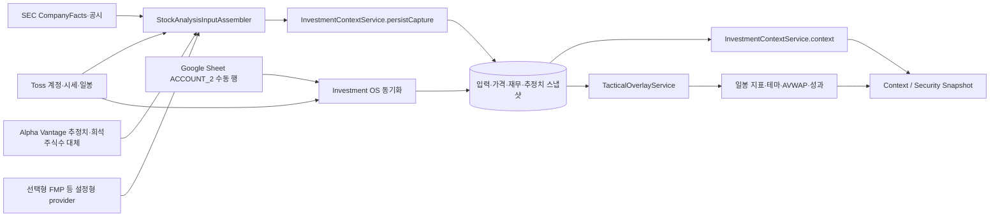

# 02. 데이터 수집과 계산

이 장은 저장소에 있는 구현과 설정을 설명한다. 코드와 기본 설정은 확인했지만, 실행 중인 배포의 환경 변수, 실제 provider 응답, 최근 수집 성공 여부는 조회하지 않았다. 따라서 **구현됨**, **저장소에 선언된 기본값/Compose 설정**, **실행 환경에서 확인되지 않음**을 구분한다.

## 한눈에 보는 흐름

수집 단계는 provider 관측값을 값, 단위, 기간, 식별자, `asOf`, 수집 시각, 결측 사유와 함께 `analysis_input_snapshots`에 보존한다. 정규화된 계산 결과는 별도 스냅샷에 저장한다. `GET /investment/context`는 이 저장 결과를 읽고 신선도 상태를 다시 표시하며 provider를 호출하지 않는다. 주요 구현은 [`InvestmentContextService`](../../trading-backend/src/main/java/com/jmj/trade/investment/InvestmentContextService.java)의 `capture`, `persistCapture`, `context`, `readPortfolio`와 [`StockAnalysisInputAssembler`](../../trading-backend/src/main/java/com/jmj/trade/marketdata/StockAnalysisInputAssembler.java)의 `assemble`이다.

## 데이터 원천과 정본 역할

| 원천 | 구현된 역할 | 정본 데이터 처리 | 설정 및 한계 |
|---|---|---|---|
| Toss Invest | 연결된 계정의 읽기 전용 계정/보유 종목/현금·매수 가능 금액 조회. 계정 연결을 통해 미국 주식 최신 시세, 미국 시장 캘린더, 검증된 정규장 종가 및 일봉도 읽는다. | 투자 가격 스냅샷과 tactical 일봉의 기준 원천이다. 최신 시세의 세션을 캘린더로 확인하지 못하면 시세와 시각은 남을 수 있지만 정규장 종가로 취급하지 않는다. | [`InvestmentContextService.tossQuotes`, `withTossQuote`, `withTossCandles`](../../trading-backend/src/main/java/com/jmj/trade/investment/InvestmentContextService.java), [`AccountSyncService.syncForMonitoring`](../../trading-backend/src/main/java/com/jmj/trade/account/AccountSyncService.java). 활성 연결과 credential이 필요하다. `stock-analysis.providers.toss.enabled`는 별도 설정형 provider 스위치이며 계정 연결 기반 경로와 같은 설정이 아니다. |
| SEC | Ticker-to-CIK 매핑, 최근 제출 내역, CompanyFacts를 이용해 신고 재무 데이터를 매핑한다. CompanyFacts로 필수 사실이 충분하지 않거나 TTM 이력이 부족할 때만 회사 Inline XBRL 자료를 보충한다. | canonical 재무 스냅샷은 SEC 관측값에서만 저장한다. 필드별 공시 식별자, 단위, 기간, 보고일과 원천 기준일을 보존한다. | 기본 `application.yml`에서는 provider 스위치가 꺼져 있다. credentialed staging Compose는 SEC를 켜고 SEC User-Agent를 요구한다. 이것은 저장소 설정일 뿐 현재 실행 여부의 증거는 아니다. 캐시와 호출 보호는 아래의 SEC 호출 경계를 참고한다. [`SecCompanyFactsProvider`](../../trading-backend/src/main/java/com/jmj/trade/marketdata/SecCompanyFactsProvider.java) |
| Alpha Vantage | 연간·분기 애널리스트 추정치와 SEC에 유효한 희석주식수가 없을 때의 대체 희석주식수를 제공한다. | canonical `latestConsensus` 조회는 Alpha Vantage 원천만 선택한다. 한편 설정형 provider의 추정 관측값은 source를 보존해 history에 저장될 수 있다. 그러므로 FMP 행이 저장돼도 현재 canonical consensus 선택의 자동 대체재는 아니다. 희석주식수 대체값도 SEC 값이 유효하지 않을 때만 사용한다. | 기본값과 Compose 기본값은 비활성이다. 기본 provider는 consensus 통화를 검증된 값으로 반환하지 않으므로 USD 통화가 필요한 forward valuation은 계산을 막을 수 있다. 논리 응답은 UTC 날짜·종목·함수 기준으로 캐시하고, durable limit은 credential마다 하루 25개 요청이다. 기본 키가 한도 소진 또는 명시적인 daily quota/invalid-key 응답을 반환하면 선택적으로 설정한 추가 키로 회전한다. burst limit와 일시적 오류는 키 회전 사유가 아니다. [`AlphaVantageEarningsEstimatesProvider`](../../trading-backend/src/main/java/com/jmj/trade/marketdata/AlphaVantageEarningsEstimatesProvider.java), [`AlphaVantageDailyRequestCache`](../../trading-backend/src/main/java/com/jmj/trade/marketdata/AlphaVantageDailyRequestCache.java), [`InvestmentContextService.persistConsensus`, `latestConsensus`](../../trading-backend/src/main/java/com/jmj/trade/investment/InvestmentContextService.java) |
| FMP | endpoint와 필드 매핑을 지정해 가져오는 선택형 provider다. credentialed Compose에는 quote, 종가 이력, 재무제표, 연간 추정치의 예시 매핑이 있다. | canonical financial 저장 경로는 SEC 원천만 읽는다. 추정 관측값은 source를 유지해 history에 저장될 수 있지만, 현재 canonical `latestConsensus` 선택은 Alpha Vantage만 조회한다. 따라서 FMP 응답이 이 정본 값을 자동 대체하지 않는다. | `STOCK_ANALYSIS_FMP_ENABLED` 기본값은 `false`. 켜도 FMP API 자격 증명과 endpoint 구성이 있어야 한다. 실패는 입력 스냅샷과 pipeline 상태에 선택 원천 결측으로 나타날 수 있으나 Toss·SEC 정본값을 대체하거나 무효화하지 않는다. [`ConfiguredStockDataProvider`](../../trading-backend/src/main/java/com/jmj/trade/marketdata/ConfiguredStockDataProvider.java), [`compose.staging.credentialed.yaml`](../../compose.staging.credentialed.yaml), [`InvestmentContextService.persistConsensus`, `latestConsensus`](../../trading-backend/src/main/java/com/jmj/trade/investment/InvestmentContextService.java) |

Provider 설정은 [`application.yml`](../../trading-backend/src/main/resources/application.yml), [`StockAnalysisProviderConfiguration`](../../trading-backend/src/main/java/com/jmj/trade/marketdata/StockAnalysisProviderConfiguration.java), [`StockDataProviderRegistry`](../../trading-backend/src/main/java/com/jmj/trade/marketdata/StockDataProviderRegistry.java)에 있다. 기본 YAML은 stock-analysis provider 스위치를 꺼 둔다. credentialed Compose overlay는 SEC를 활성화하고 Alpha Vantage와 FMP는 환경 변수 없이는 계속 꺼 둔다. 운영 배포에서 어떤 토글과 credential이 공급됐는지는 이 저장소만으로 확인할 수 없다. 비밀 값은 이 문서에 기록하지 않는다.

### SEC 호출, 캐시와 제한된 fallback

`SecCompanyFactsProvider`는 ticker map, issuer의 submissions와 CompanyFacts, 그리고 필요할 때 요청한 filing별 inline 결과를 provider 인스턴스 메모리에 캐시한다. 생성자 기본 TTL은 6시간이고 허용 최대는 1일이다. 같은 issuer가 TTL 안에 다시 처리되면 submissions/CompanyFacts를 재사용하며, cache miss 때 두 SEC JSON 경로를 요청한다. 이 캐시는 durable 저장소가 아니어서 프로세스 재시작 후에는 다시 채워진다. Ticker map, submissions 또는 CompanyFacts 응답 자체가 없거나 issuer 검증에 실패하면 SEC provider 입력이 unavailable이 된다. 이 경우 임의의 filing을 전수 탐색해 대체하는 경로는 없으며, inline fallback은 정상 CompanyFacts·submissions로 대상 issuer와 eligible filing을 확인한 뒤 일부 사실을 보완할 때만 수행된다.

Inline XBRL은 모든 공시를 무조건 내려받지 않는다. 최신 filing의 CompanyFacts에 필요한 현금·부채·매출·현금흐름·주식수/EPS/희석주식수 등 필수 사실이 없거나 EBITDA/매출 TTM 이력이 없을 때 최신 filing을 먼저 확인한다. 이전 filing은 누락된 TTM을 보충할 수 있는 경우에만 후보가 된다. 후보 범위는 최근 550일 안의 최대 6개 서로 다른 report period이며 filing별 결과도 위 TTL로 캐시된다. 결과적으로 fallback 실패가 있어도 원천 API 관측값이 반드시 보충되는 것은 아니며, 관련 필드에 구체적인 Inline XBRL 결측 사유가 붙을 수 있다.

SEC transport는 [`ProviderCatalog`](../../trading-backend/src/main/java/com/jmj/trade/marketdata/ProviderCatalog.java)에서 User-Agent 필수 provider로 선언돼 있다. [`ProviderHttpTransport`](../../trading-backend/src/main/java/com/jmj/trade/marketdata/ProviderHttpTransport.java)는 비어 있지 않은 설정값을 실제 `User-Agent` 헤더에 넣고, SEC profile에 값이 없으면 transport 생성을 거부한다. [`ProviderRateLimiter`](../../trading-backend/src/main/java/com/jmj/trade/marketdata/ProviderRateLimiter.java)는 SEC 요청에 process-wide 공유 상태를 사용하며 정책 설정이 더 낮은 호출 속도를 요구하면 그 정책을 따르되 최소 500ms 간격(초당 최대 2회)을 적용한다. credentialed staging 설정은 `requests-per-window: 2`, `rate-limit-window: PT1S`, `max-retries: 3`, `retry-backoff: PT1S`다. 기본 YAML에는 별도 SEC transport 정책이 없으므로 이 staging 값과 동일하다고 간주하면 안 된다.

HTTP 429는 `Retry-After` 또는 정책의 지수 backoff를 비교해 대기한다. backoff는 30초까지 제한되며, 서버의 `Retry-After`가 30초보다 길면 해당 요청은 `HTTP_429`로 종료하고 limiter cooldown은 서버가 지정한 기간을 따른다. 저장소 설정과 코드 동작에 관한 설명이며 현재 SEC 응답 성공, 배포별 재시도 설정 또는 provider quota를 보증하지 않는다.

## 수집 대상과 일정

수집 대상 사용자는 활성 broker 연결이 있거나 `WATCH`, `PREPARE`, `ACTION_CANDIDATE` 상태 watchlist가 있는 사용자다. 종목은 보유 종목, 해당 watchlist, `investment.data.additional-symbols`, tactical `tracked-symbols`의 합집합이다. 기본 추가·tactical universe는 `AVT`, `CSTM`, `GOOGL`, `LUNR`, `RDW`, `VST`로 설정돼 있다. universe 등록은 포지션이나 수량을 만들지 않는다. 대상 계산은 `InvestmentContextService.captureUsers`와 `captureSymbols`를 따른다.

스케줄은 New York 시간이다. 아래는 [`InvestmentDataScheduler`](../../trading-backend/src/main/java/com/jmj/trade/investment/InvestmentDataScheduler.java)의 `@Scheduled` 기본식이다. 스케줄러 Bean은 [`InvestmentDataSchedulerConfiguration`](../../trading-backend/src/main/java/com/jmj/trade/investment/InvestmentDataSchedulerConfiguration.java)에서 `investment.data.scheduler.enabled=true`일 때만 만들어진다. 애플리케이션과 기본 Compose의 스위치는 `false`이므로 cron 선언만으로 실행을 뜻하지 않는다.

| 작업 | 코드 기본 일정 | 실행 내용 | 설정 경계 |
|---|---|---|---|
| 장 마감 후 | 월–금 16:15 (`0 15 16 * * MON-FRI`) | `afterClose()`가 전체 투자 데이터 캡처를 호출한다. SEC 재무·추정치 입력, Toss 정규 종가 및 일봉, tactical 재계산을 포함한다. | `INVESTMENT_DATA_AFTER_CLOSE_CRON`; 저장소 기본 Compose가 전달한다. 거래소 휴장일을 cron에서 제외하지 않는다. |
| 주말 캡처 | 토·일 16:15 (`0 15 16 * * SAT,SUN`) | `weekendAfterClose()`가 전체 캡처를 호출해 주말에도 일별 실행 기회를 제공한다. | `INVESTMENT_DATA_WEEKEND_CAPTURE_CRON`; 기본 Compose와 credentialed overlay에 명시돼 있다. |
| 장 폐장 구간 증거 | 월–금 20:15 (`0 15 20 * * MON-FRI`) | `afterClosedInterval()`은 `capture(..., true)` 경로를 호출한다. 세션/폐장 구간 확인 목적의 quote-only 실행이며 재무와 일봉 전체 수집은 하지 않는다. | `INVESTMENT_DATA_CLOSED_INTERVAL_EVIDENCE_CRON` 프로퍼티는 YAML에 있으나 확인한 Compose 환경 목록에서 별도 전달하지 않는다. 다른 배포 설정이 주입되지 않으면 YAML 기본값이다. |
| 장 전 포트폴리오 갱신 | 월–금 08:00 (`0 0 8 * * MON-FRI`) | `beforeMarket()`이 `refreshPortfolios()`를 호출해 활성 broker 연결의 포트폴리오를 읽기 전용 갱신한다. 종목 재무 캡처는 아니다. | `INVESTMENT_DATA_PRE_MARKET_CRON`; 기본 Compose에 전달한다. |
| 장 전 quote 캡처 | 월–금 04:00부터 09:00까지 매시 (`0 0 4-9 * * MON-FRI`) | `preMarketQuoteCapture()`가 quote/session 등 선택된 quote 필드만 갱신한다. | `INVESTMENT_DATA_PRE_MARKET_CAPTURE_CRON` 프로퍼티가 YAML에 선언돼 있지만 확인한 Compose 환경 목록에는 별도 전달이 없다. 다른 설정이 없으면 YAML 기본값이다. |
| 장중 | 최초 지연 1분 후 고정 지연 5분 | `intraday()`가 초기 포트폴리오·정본 부트스트랩과 캘린더 증거 확보를 먼저 시도한다. 이후 평일 09:30 이상 16:00 미만에 quote-only 캡처한다. | `INVESTMENT_DATA_INITIAL_DELAY`, `INVESTMENT_DATA_INTRADAY_INTERVAL`; 기본 Compose가 전달한다. 코드의 장중 창은 거래소 휴장일을 확인하지 않는다. |

정본 전체 수집은 현재 Toss 정규 종가와 신선한 SEC 현금·매출 TTM 자료가 필요하다. 코드의 초기 부트스트랩은 필요한 정본 데이터가 없을 때 재시도하며 제한 횟수 이후에도 정기 캡처는 유지한다. `SECURITY_DATA`는 canonical 필수 데이터 누락 또는 수집 관측값이 전혀 없으면 `FAILED`가 된다. 이 필수 조건을 통과한 실행에서 provider 실패, observation 결측, readiness 필드 결측 또는 Tactical 보강 결측이 있으면 `PARTIAL`; 그런 누락이 없으면 `SUCCEEDED`가 된다. 즉 선택 provider가 실행에서 활성화되지 않았다는 사실만으로 이 pipeline이 반드시 `PARTIAL`인 것은 아니며, 개별 section/metric 상태는 따로 읽어야 한다. `PARTIAL` 실행은 `last_success_at`을 이번 시각으로 갱신하므로 완전한 데이터 성공을 뜻하지 않는다. `FAILED`는 null 값을 전달해 기존 `last_success_at`을 유지한다. `SECURITY_QUOTE_UPDATE`는 별도 파이프라인이며 정규 종가·재무·일봉 저장을 대신하지 않는다.

기본 cron과 Compose 전달 변수는 [`application.yml`](../../trading-backend/src/main/resources/application.yml), [`compose.yaml`](../../compose.yaml), [`.env.example`](../../.env.example), [credentialed Compose overlay](../../compose.staging.credentialed.yaml)에 나뉘어 있다. 환경 변수 이름이 `.env.example`에 있다는 사실만으로 컨테이너에 전달되지는 않는다. 이 파일들로 확인되는 것은 코드 기본값과 선언된 오버라이드 경로뿐이며, 현재 배포의 최종 설정·스케줄 실행 이력은 미확인이다.

## canonical 포트폴리오와 수동 계정 신선도

`InvestmentContextService.readPortfolio`는 두 경로 중 하나를 읽는다.

| 경로 | 선택 조건 | 포트폴리오 구성과 제한 |
|---|---|---|
| broker snapshot 경로 | Investment OS Sheet가 꺼져 있거나 해당 사용자가 설정 소유자가 아님 | 사용자의 활성 broker 연결별 성공 snapshot을 합산한다. 같은 종목은 통화가 같을 때 수량·평가액을 더한다. 통화가 섞이면 `MIXED_CURRENCY_POSITION`을 표시하고 해당 종목의 신뢰 가능한 weight를 만들지 않는다. 공통 종목 통화의 계정 총액이 양수이고 다른 통화 잔액이 0일 때만 종목 평가액을 계정 총액으로 나눠 weight를 계산한다. 자동 FX 환산은 없다. |
| combined Sheet 경로 | `investment-os.sheet.enabled=true`이고 현재 사용자가 설정된 Sheet owner | PostgreSQL에 저장된 마지막 accepted payload를 읽는다. broker 소유 `ACCOUNT_1`과 수동 입력 `ACCOUNT_2`를 결합하며, Google Sheets를 context GET 중에 직접 읽지 않는다. `ACCOUNT_2`는 Account Registry가 `Sync Mode=MANUAL`, `Enabled=TRUE`로 확인돼야 한다. 결합 USD 총액과 holding별 값이 없거나 통화가 혼합되면 weight/위험 계산에 필요한 값은 누락 상태로 둔다. |

combined Sheet 경로의 `ACCOUNT_1`은 연결된 Toss 계정이고 `ACCOUNT_2`는 수동 데이터다. USD aggregate는 Sheet의 결합 total을 이용한다. KRW 현금은 검증된 환율 변환이 없으므로 combined USD total에 합산하지 않는다. 수동 행은 각 행의 `As Of`를 우선 사용하며, 해당 열이 없거나 비어 있을 때만 유효한 `Synced At`을 대체 시각으로 쓴다. 읽기 시각이나 `Price Synced At`을 수동 보유량의 기준일로 간주하지 않는다. source와 기준일은 가격 갱신과 분리해 보존한다.

| 신선도/품질 기준 | 기본값·효과 |
|---|---|
| broker snapshot | `portfolio.snapshot.max-age` 기본 15분. 최신 동기화가 실패 또는 진행 중이면 성공 이력이 있더라도 별도 stale 사유가 보인다. |
| Toss quote 및 포트폴리오 가격 | 투자 데이터의 quote freshness 기본 15분. quote timestamp, 가격 일치, 수량·시장가치 누락을 확인한다. 검증된 폐장 구간 정보가 있으면 다음 Toss 세션 전까지 제한적으로 freshness를 유지할 수 있다. 공식 캘린더나 폐장 provenance를 확인할 수 없으면 예외를 추정 적용하지 않는다. |
| ACCOUNT_2 수동 기준일 | Asia/Seoul 달력 기준 최대 7일 전까지 허용하며 미래 날짜는 유효하지 않다. 행은 있지만 유효한 기준일/상태가 없으면 `MANUAL_AS_OF_MISSING` 또는 미검증 상태로 남는다. |
| combined total / weight | combined USD total이 없거나 양수가 아니면 `COMBINED_USD_TOTAL_UNAVAILABLE`; 위치별 수량/시장가치/가격이 모자라면 이유를 position별로 기록한다. 숫자를 0으로 메우지 않는다. |
| 실패한 Sheet sync | 마지막 accepted combined snapshot을 보존한다. 실패한 최근 시도는 context에 stale/missing 사유로 노출되며 ACCOUNT_1만으로 조용히 대체하지 않는다. |

수동 계정은 [`InvestmentOsSheetSyncService`](../../trading-backend/src/main/java/com/jmj/trade/sheets/InvestmentOsSheetSyncService.java)가 읽고 accepted snapshot으로 저장한다. [`InvestmentOsSheetModel`](../../trading-backend/src/main/java/com/jmj/trade/sheets/InvestmentOsSheetModel.java)의 `manualAccountEnabled`, `manualRowsHaveVerifiedMetadata`, `aggregate`가 유효성을 판정한다. context에서는 [`InvestmentContextService.readSheetPortfolio`, `sheetPositions`, `sheetTimestampCurrent`](../../trading-backend/src/main/java/com/jmj/trade/investment/InvestmentContextService.java)가 snapshot payload를 해석한다. 부가 운영 상세는 [Investment OS Sheet sync](../ops/investment-os-sheet-sync.md)를 참고한다.

## 재무 매핑, 출처와 계산

입력 관측값은 `field`, `provider`, `unit`, `period`, `identifier`, `asOf`, `collectedAt`, `missingData`, `asOfBasis`를 갖는다. SEC 신고자료는 원천의 공시 기준일을 `asOf`로 둔다. Alpha Vantage 예측치는 provider 응답을 관측한 시각을 보존한다. 따라서 수집 시각이 원천 기준일을 대신하지 않는다. 회사 재무값·계산값에는 `fieldProvenance`로 개별 필드의 출처, 기준일, 단위, 기간/식별자와 산식이 연결된다.

| canonical 필드 | 입력 및 선택 규칙 | 계산/표시 |
|---|---|---|
| `basicShares` | SEC DEI `EntityCommonStockSharesOutstanding`와 GAAP 보통주 주식수 중 최신 유효 관측을 고른다. | 주식수 기준(태그/instant), 단위, 공시 식별자를 보존한다. |
| `dilutedShares` | SEC 가중평균 희석주식수가 유효하면 사용한다. 아니면 Alpha Vantage 대체값을 사용할 수 있다. | basis에 공급자/유형을 기록한다. 기본 시가총액과 분리된 희석 시가총액 계산에 쓴다. |
| `cash`, `debt` | SEC CompanyFacts의 최신 신고 사실을 사용한다. 부채 총계 직접 태그가 없으면 같은 종료일·accession에 맞는 현재/비유동 부채 구성값을 합산하는 경로가 있다. | 현금과 부채의 관측 시각은 각각 보존한다. Enterprise Value에는 두 필드의 통화가 검증돼야 한다. |
| `revenueTTM` | SEC 재무제표에서 최신 적격 fiscal period의 4개 연속 분기 흐름값을 구성한다. | 금액, 통화, fiscal period 및 소스 태그를 기록한다. |
| `revenueGrowthYoY` | 연간 filing이 있으면 연간 비교, 그렇지 않으면 분기 정보와 매출 TTM을 이용하는 경로를 적용한다. | 비율 필드와 기반 fiscal 기간을 보존한다. |
| `eps`, `fcfTTM` | SEC 희석 EPS 사실. FCF는 영업활동 현금흐름 TTM에서 PPE 취득 현금흐름 TTM을 뺀다. | 계산 FCF의 기반 SEC 사실과 기간을 provenance로 남긴다. |
| `ebitdaTTM` | SEC의 최근 4개 연속 분기 순이익, 세금, 이자, 감가상각·상각 사실을 사용한다. 총 D&A가 없으면 조정된 감가상각 및 무형자산 상각 태그를 조합할 수 있다. | `CALCULATED` 유형, 공식 문자열, SEC source facts를 별도로 노출한다. 보고 EBITDA와 혼동하지 않도록 계산형임을 표시한다. |
| `consensus` | Alpha Vantage 추정 응답에서 미래 fiscal year/quarter의 revenue·EPS 추정치, estimate label, 기간 종료일, 분석가 수를 저장한다. 동일 기간의 상충 응답은 source conflict로 처리한다. | 연간/분기 유형을 합치지 않으며 해당 추정치의 `asOf`, period end, horizon 및 통화를 함께 표시한다. 기본 구현은 verified consensus currency를 제공하지 않는다. |

이 매핑의 소스는 [`SecCompanyFactsProvider.map`](../../trading-backend/src/main/java/com/jmj/trade/marketdata/SecCompanyFactsProvider.java), [`AlphaVantageEarningsEstimatesProvider.readEstimates`](../../trading-backend/src/main/java/com/jmj/trade/marketdata/AlphaVantageEarningsEstimatesProvider.java), [`InvestmentContextService.persistFundamentals`, `persistConsensus`, `fundamentalProvenance`](../../trading-backend/src/main/java/com/jmj/trade/investment/InvestmentContextService.java)다. 정본 재무 스냅샷은 `source=SEC`만 읽는다. 모든 수치의 기준일을 같은 날짜라고 가정하지 않는다.

`InvestmentDataCalculator`와 `InvestmentContextService.valuation`의 주요 규칙은 다음과 같다.

| 지표 | 계산식·입력 | 사용 조건 |
|---|---|---|
| Regular market cap | Toss 검증 정규 종가 × SEC 기본 주식수 | 두 입력을 각각 추적하며 가격의 기준일과 주식수의 SEC 기준일을 독립 보존한다. |
| Fully diluted market cap | Toss 검증 정규 종가 × 사용 가능한 diluted shares | 별도 필드로 두고 diluted shares source/basis를 보존한다. |
| Enterprise value | market cap + 최신 SEC debt − 최신 SEC cash | balance-sheet 입력 통화가 USD로 확인돼야 한다. 음수 결과도 산술상 유효하다. |
| TTM EV/Sales, EV/EBITDA | Enterprise value ÷ SEC 매출 TTM 또는 계산 EBITDA TTM | 분모가 없으면 missing; 분모가 0 이하이면 지표별 비적용 상태가 될 수 있다. |
| Forward EV/Sales, EV/EBITDA | Enterprise value ÷ 연간 consensus | 연간 추정치만 허용하고 추정 통화가 검증돼야 한다. 분기 추정치는 대체로 넣지 않는다. |
| Forward P/E | Toss 정규 종가 ÷ 연간 EPS consensus | 연간 추정치와 검증 통화가 필요하다. 기본 Alpha 구현의 통화 결측은 이 계산을 차단할 수 있다. |
| FCF yield | FCF ÷ market cap | TTM은 SEC 계산 FCF, forward는 연간 consensus FCF를 사용하며 forward도 통화 확인이 필요하다. 음수 yield는 유효한 값이다. |
| Normalized FCF | 최근 서로 다른 3개 fiscal period의 FCF TTM 평균 | 세 기간이 모이지 않으면 `INSUFFICIENT_FCF_HISTORY`; 해당 기간별 provenance를 남긴다. |

각 valuation metric은 숫자만 반환하지 않고 `metricStatuses`, `metricReasons`, `metricProvenance`를 함께 반환한다. Provenance는 공식, 입력별 출처·시각, 단위, estimate 유형·기간을 담는다. 값이 존재해도 가격/재무/합의 입력의 freshness, USD 단위 또는 기준일 검증이 실패하면 stale, unverified, partial 상태일 수 있다. Thesis 분류는 valuation readiness에서 필요한 지표 묶음을 고르는 데 쓰인다. 분류가 없더라도 가용한 TTM 지표 자체를 표시할 수 있다. 상세 계약은 [canonical investment data](../ops/canonical-investment-data.md)에 있다.

투자 데이터 freshness 기본 창은 최신 quote 15분, regular close 7일, fundamental 입력 210일, consensus 입력 10일이다. 이는 [`application.yml`](../../trading-backend/src/main/resources/application.yml)의 `investment.data.*-stale-after` 설정이며 환경별로 바뀔 수 있다. `InvestmentContextService.refreshStoredFreshness`는 저장된 값을 읽을 때 해당 창을 적용하므로 원천 숫자와 freshness status를 함께 읽어야 한다.

Consensus revision은 동일 source, `estimateType`, `horizon`(기간)의 과거 관측만 비교한다. revenue와 EPS 각각 30일·90일 기준을 계산하며, 기준 시점은 현재 관측 시각에서 해당 기간만큼 이전인 시각 이하의 가장 가까운 스냅샷이다. 변화율은 `(현재값 - 기준값) / abs(기준값) × 100`이다. 기준값이 0이면 `UNVERIFIED`; 기준 스냅샷이 없으면 `INSUFFICIENT_HISTORY`; 현재 관측값이 없으면 `DATA_MISSING`이다. 통화 검증은 forward valuation에 필요하지만 동일 공급자/기간의 revision 산술에는 적용하지 않는다. 구현은 [`InvestmentDataCalculator.revision`](../../trading-backend/src/main/java/com/jmj/trade/investment/InvestmentDataCalculator.java), [`InvestmentContextService.revisions`](../../trading-backend/src/main/java/com/jmj/trade/investment/InvestmentContextService.java)이다.

## 일봉 지표, 테마, AVWAP와 성과

일반 투자 technical section은 저장된 Toss 정규 종가를 사용해 SMA20, SMA50, RSI14와 표본 수를 만든다. Tactical overlay는 별도의 일봉 OHLCV 계산 경로다. 현재 통합은 Toss의 정규장 일봉을 `UNADJUSTED`로 저장하고 split conflict 일자를 공급하지 않는다. 따라서 현재 tactical 결과를 분할 조정 가격으로 해석하면 안 된다. 계산기는 입력이 주어지면 split conflict를 표시할 수 있지만 현재 서비스 연결이 해당 정보를 만들지는 않는다.

| 지표/결과 | 현재 정의와 입력 경계 |
|---|---|
| EMA9/21/50 | 각 길이만큼 첫 완전한 일봉의 단순 평균을 최초값으로 하고, 이후 `alpha=2/(N+1)`인 EMA를 계산한다. 해당 길이의 warm-up 전에는 `INSUFFICIENT_HISTORY`. |
| RVOL | 현재 일 거래량을 직전 20개 일봉 거래량 평균으로 나눈다. 현재 봉은 분모에서 제외한다. |
| DailyVWAP20Proxy | 현재 봉 포함 최근 20개 일봉의 `typical price × volume` 합을 거래량 합으로 나눈다. typical price는 `(high + low + close) / 3`. **일봉 proxy이며 intraday VWAP 또는 체결 가격이 아니다.** |
| Return20/60, RS20/60 | 정확히 지정된 이전 거래 봉과 비교한다. 상대강도는 동일 두 날짜에서 종목 gross return을 SPY gross return으로 나눈 비율이다. SPY 날짜를 앞/뒤 가격으로 채우지 않는다. |
| trend stage / events | 50개 봉 이전에는 stage가 비거나 불충분 상태다. `BASE`, `EARLY_UPTREND`, `CONFIRMED_UPTREND`, `EXTENDED`, `DISTRIBUTION`, `BREAKDOWN` 및 reclaim, breakout, 실패, high-RVOL breakout, breakdown 이벤트를 deterministic 규칙으로 계산한다. |
| breakout cohort | breakout 뒤의 정확한 일봉 수가 지나야 결과가 성숙한다. 기본 horizon은 3·5 거래 봉이며, 미성숙 cohort는 성공률 분모에 넣지 않고 결측 사유/개수로 남긴다. |
| theme aggregates | 명시적으로 입력된 effective-dated theme membership을 쓴다. 한 공통 기준일의 종가만 사용하고 가능한 종목들을 동일 가중 평균한다. breadth, median RVOL, breakout 수·성공률을 계산하며 expected/eligible 수와 missing 이유를 보존한다. 결측 종목을 0으로 대체하지 않는다. |
| DailyAVWAP | 명시된 anchor ID와 anchor date가 실제 저장 봉 날짜와 일치할 때만 계산한다. 시작 봉을 포함해 `typical price × volume` 누적합을 누적 거래량으로 나눈다. anchor type은 earnings gap, breakout, catalyst, major low, position entry다. |
| Performance entry | 진입일/가격과 초기 위험 가격은 입력으로 저장한다. 주당 위험은 진입가−stop가이며 수량 입력이 있을 때만 초기 위험 금액을 계산한다. Current R은 `(신선한 Toss mark − 진입가) / 주당 위험`이며 일봉 종가로 대체하지 않는다. Realized R은 입력된 청산만 사용한다. MAE/MFE 및 forward return은 완결 일봉으로 계산한다. |

Tactical 계산 기본값은 breakout lookback 20봉, buffer 0, extension threshold 10%, high-RVOL 기준 2.0배, cohort horizon 3·5봉, 성과 horizon 5·20봉, current mark freshness 15분이다. 설정 클래스는 [`TacticalOverlayProperties`](../../trading-backend/src/main/java/com/jmj/trade/investment/tactical/TacticalOverlayProperties.java)다. daily OHLCV에서는 intraday 진입 순서를 알 수 없어 entry-day 고저가를 MAE/MFE에 넣지 않는다. 명시적으로 전량 청산된 경우 마지막 청산일의 고저가도 excursion window에서 뺀다.

테마·anchor·performance 입력은 사용자가 날짜와 provenance를 명시하는 append-only 입력이다. 테마 분류, 회원 종목, AVWAP anchor, 진입/stop/청산을 자동 추정하지 않는다. quote-only 캡처는 저장된 일봉을 새로 요청하지 않고, 기존 일봉과 신선한 Toss mark로 configured performance 결과만 갱신할 수 있다. Context 읽기 자체는 계산 입력을 수정하거나 provider를 다시 호출하지 않는다. 구현은 [`TacticalOverlayService.refresh`, `context`, `putAnchor`, `putThemeMapping`, `putPerformanceEntry`, `refreshPerformanceMarks`](../../trading-backend/src/main/java/com/jmj/trade/investment/tactical/TacticalOverlayService.java), [`TacticalOverlayCalculator.calculate`](../../trading-backend/src/main/java/com/jmj/trade/investment/tactical/TacticalOverlayCalculator.java), [`TacticalOverlayAggregationCalculator`](../../trading-backend/src/main/java/com/jmj/trade/investment/tactical/TacticalOverlayAggregationCalculator.java)다. 상세 API와 edge-case 공식은 [Tactical Overlay V1 calculations](../ops/tactical-overlay-v1-calculations.md)를 참고한다.

## 결측·상충·신선도 상태 읽기

숫자 `null`은 0을 뜻하지 않는다. 정본 portfolio, security, valuation, tactical 각 부분은 독립 상태와 사유를 반환할 수 있다.

| 상태 | 읽는 법 |
|---|---|
| `OK` | 해당 계산이 필요한 입력과 검증을 통과했다. 다른 section도 정상이라는 뜻은 아니다. |
| `PARTIAL` | 일부 값은 계산 가능하지만 일부 필드, 대상 종목, provenance 또는 provider 응답이 빠졌다. 해당 필드의 값과 누락 사유를 함께 봐야 한다. |
| `DATA_MISSING` | 계산에 필요한 원천/값이 없다. 0값으로 보간하지 않는다. |
| `INSUFFICIENT_HISTORY` | 데이터는 있을 수 있으나 지정한 lookback, baseline 또는 성숙 horizon이 부족하다. |
| `STALE` | 기준 시각은 있으나 설정된 freshness 창을 넘었다. 숫자가 과거에 유효했음을 의미할 뿐 현재값으로 보장하지 않는다. |
| `SOURCE_CONFLICT` | 같은 세션·기간의 가격 또는 financial 입력에서 해결되지 않은 충돌이 발견됐다. 해당 section/metric을 신뢰 가능한 단일값으로 취급하지 않는다. |
| `UNVERIFIED` | 값은 존재해도 단위, 통화, timestamp, baseline 등 필요한 확인이 부족하다. |
| `NOT_APPLICABLE` | 해당 지표 조건상 계산 대상이 아니다. 분모가 0 이하인 지표 등은 이 상태일 수 있다. |
| `NOT_CONFIGURED` | 선택 기능/입력 구성이 없다. 이는 측정값 0이나 수집 실패와 다르다. |
| `CORPORATE_ACTION_CONFLICT` | split conflict 날짜가 비교 구간에 들어와 결과를 억제했다. 현재 integrated Toss bars에는 split metadata가 연결돼 있지 않다. |

파이프라인 상태(`RUNNING`, `SUCCEEDED`, `PARTIAL`, `FAILED`)와 개별 지표 상태는 서로 다른 층이다. `SUCCEEDED`는 해당 capture 집계 검사가 통과했다는 뜻이며, 비활성 provider가 제공할 필드나 해당 실행에서 선택하지 않은 quote-only 필드까지 모두 존재한다는 뜻은 아니다. 현재 capture 입력에서 결측 observation이 잡히고 canonical 필수 조건은 충족되면 pipeline은 `PARTIAL`이 된다. `last_success_at`은 `PARTIAL`에서도 갱신되므로 완전성 판정으로 쓰지 않는다. Readiness는 Price, Trend, Fundamental, Consensus, Revision, Valuation, Balance Sheet, Risk를 분리해 보여준다. `overallDataStatus`만 보고 개별 원인이나 금융 입력 신뢰도를 생략하지 않는다.

## 확인한 주요 파일

- 수집과 정본 매핑: [`InvestmentDataScheduler`](../../trading-backend/src/main/java/com/jmj/trade/investment/InvestmentDataScheduler.java), [`InvestmentContextService`](../../trading-backend/src/main/java/com/jmj/trade/investment/InvestmentContextService.java), [`InvestmentDataCalculator`](../../trading-backend/src/main/java/com/jmj/trade/investment/InvestmentDataCalculator.java)
- provider 및 provenance: [`StockAnalysisInputAssembler`](../../trading-backend/src/main/java/com/jmj/trade/marketdata/StockAnalysisInputAssembler.java), [`SecCompanyFactsProvider`](../../trading-backend/src/main/java/com/jmj/trade/marketdata/SecCompanyFactsProvider.java), [`AlphaVantageEarningsEstimatesProvider`](../../trading-backend/src/main/java/com/jmj/trade/marketdata/AlphaVantageEarningsEstimatesProvider.java), [`StockAnalysisProviderConfiguration`](../../trading-backend/src/main/java/com/jmj/trade/marketdata/StockAnalysisProviderConfiguration.java)
- 수동/combined portfolio: [`InvestmentOsSheetSyncService`](../../trading-backend/src/main/java/com/jmj/trade/sheets/InvestmentOsSheetSyncService.java), [`InvestmentOsSheetModel`](../../trading-backend/src/main/java/com/jmj/trade/sheets/InvestmentOsSheetModel.java), [`PortfolioReadService`](../../trading-backend/src/main/java/com/jmj/trade/account/PortfolioReadService.java)
- tactical calculations: [`TacticalOverlayService`](../../trading-backend/src/main/java/com/jmj/trade/investment/tactical/TacticalOverlayService.java), [`TacticalOverlayCalculator`](../../trading-backend/src/main/java/com/jmj/trade/investment/tactical/TacticalOverlayCalculator.java), [`TacticalOverlayAggregationCalculator`](../../trading-backend/src/main/java/com/jmj/trade/investment/tactical/TacticalOverlayAggregationCalculator.java)
- 기존 계약 문서: [Canonical investment data](../ops/canonical-investment-data.md), [Investment OS Sheet sync](../ops/investment-os-sheet-sync.md), [Tactical Overlay V1 calculations](../ops/tactical-overlay-v1-calculations.md)
